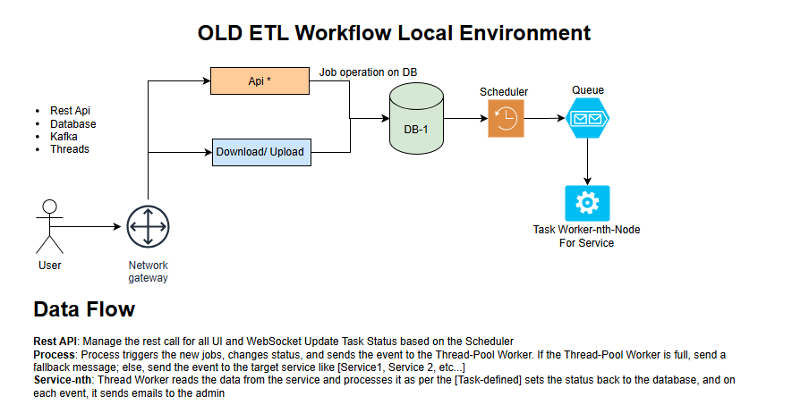
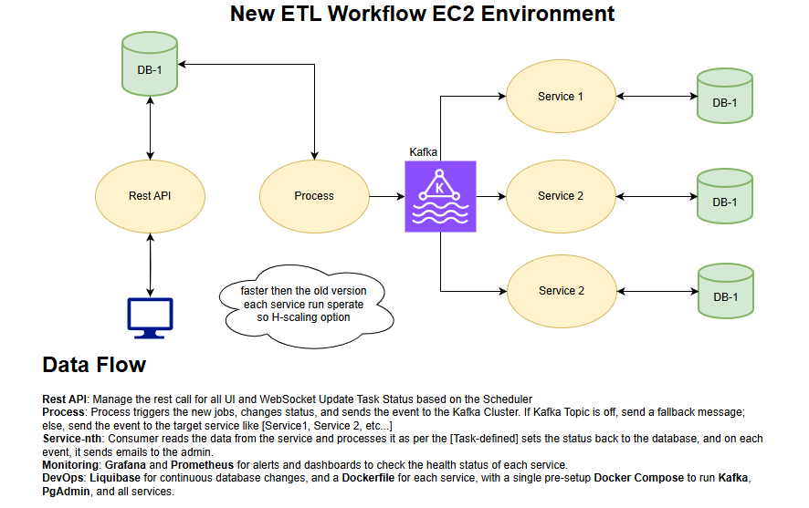
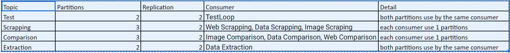
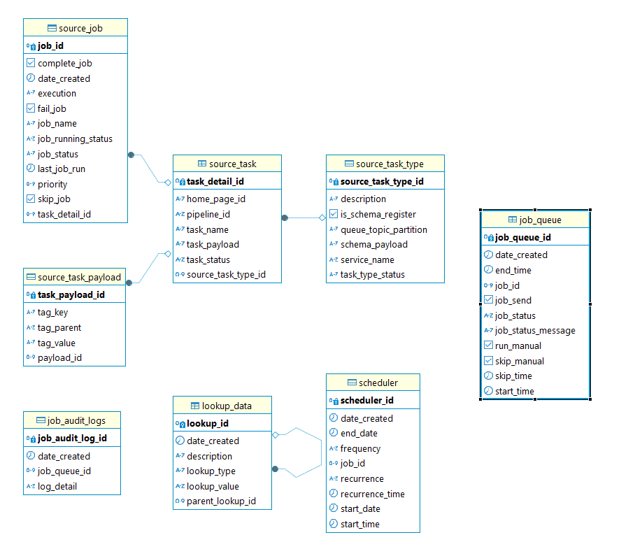

# ETL Console — backend

**Running the platform:** every service, its settings and its secrets are started from [etl-platform](https://github.com/NABEEL-AHMED-JAMIL/etl-platform) (`../etl-platform`): `scripts/up.sh`, `scripts/deploy.sh <service>`, `scripts/verify.sh`. This repository's own `docker-compose.yml` still works for standalone development, but once the service runs from etl-platform its `.env` here no longer configures the running container -- change `etl-platform/config/` or `etl-platform/secrets/` instead.

The server behind the ETL Console ("Core"). It began as a Kafka-backed **scheduler engine**, and that is still its core: 51 REST controllers (16 of them `/internal`, 7 the customer API; as of 2026-10-12) cover pipelines and the step engine, schedules, runs and their review, forms, inbox triggers, reports and the customer API's runs, events and reads. Identity, storage, media and documents, and analytics have moved out to their own services (MIG-108, MIG-70, MIG-48, MIG-128), beside ai-, billing-, integration- and workflow-service; Core reaches them over HTTP and Kafka.

Its frontend is the Angular 22 console in [`../scheduler1`](../scheduler1) (`next-app`, served on :4400 by etl-platform). The older Angular 8 console was retired on 2026-09-24.

> **As of 2026-10-13** (branch `media-extraction`): a pipeline's run parameters (`{{param.name}}`, `{{run.date}}`, `{{run.windowStart}}`, `{{run.windowEnd}}` in any step) and backfills -- a schedule run once for each day, hour or week of a past range, a few at a time ([Backfill and run parameters](#backfill-and-run-parameters-mig-347)); monitoring that alerts (MIG-355). Migrations V210–V211.

> **As of 2026-10-12** (branch `media-extraction`): a failed run retries from its failed step (MIG-345); the append, approval, send_webhook, sort, limit and read_documents steps, and a "When a document is approved" job trigger (MIG-346, MIG-365, MIG-364); render_pdf streams (ADR-027); reviewers read the run they review; runs are approved or rejected in bulk ([Run review and bulk review](#run-review-and-bulk-review-2026-10-12)). Migrations V205–V209.

> **As of 2026-10-07** (branch `media-extraction`, platform-commons 1.16.0): the step engine streams big files and spills to disk (ADR-026 phase 1, MIG-344); Read API, Aggregate, Compute, Send Notification and Measure image gained the features listed under [Pipeline steps](#pipeline-steps-as-of-2026-10-12); the customer API's runs, pipelines, events, files, reviews and view links are served here ([The customer API in Core](#the-customer-api-in-core-mig-332333334335-adr-025)). Architecture records: `../etl-platform/docs/adr/ADR-026-big-data-step-engine.md`, `ADR-025-customer-api.md`.

> The planning and per-feature scope for the current phase is in [`../.ai/`](../.ai/). Start with [`../.ai/project.md`](../.ai/project.md), and see [`../.ai/discovery/backend.md`](../.ai/discovery/backend.md) for the full endpoint and service inventory.

## The scheduler

```
Process has 6 types of scheduler
1. Mint    (runs on a minute interval,  e.g. every 5 minutes)
2. Hr      (runs hourly,                e.g. every 1 hour)
3. Daily
4. Weekly
5. Monthly
6. Cron    (the schedule's own cron expression, scheduler.cron_expression, V187)
```

These are exactly the values of `process.model.enums.Frequency`.

### Architecture

1. **Producer** — sends job/task messages into Kafka topics
2. **Scheduler engine** — pulls due jobs, applies scheduling logic, dispatches them
3. **Consumer** — reads results and error events back off Kafka
4. **Step engine** — a pipeline with a step definition runs inside Core (`process.pipeline.StepEngine`, MIG-230; streaming per ADR-026, below). The engine takes the run and reports through the same callback a worker uses (`NotifyService.changeState`), so statuses, retries, mails and metering are unchanged. A pipeline without one (a "Legacy" task) is still published through `dispatch_outbox` to its worker's Kafka queue, but no worker is part of the platform any more: the Python workers (`../job-search`) were retired on 2026-09-24 and the step engine replaced them (the Java `service-1` worker is a test executor only).

Concurrency comes from Spring's own scheduling pool, sized by `spring.task.scheduling.pool.size`, and the step engine's own threads (`process.pipeline.engine.threads`, default 4). (Earlier versions of this README described a `ThreadPoolExecutor` with a `PriorityBlockingQueue`; no such code exists today.)

## Tech stack

| | |
|---|---|
| **Java 17 / Spring Boot 2.7.18** | Core engine. Java 17 bytecode, JDK 17 runtime (MIG-204) |
| **Apache Kafka** (`cp-kafka` 7.5.0 + ZooKeeper) | Messaging and stream processing |
| **PostgreSQL 15** | Required, not optional. Schema managed by **Liquibase** (`src/main/resources/db/changelog/`): the V50.0 baseline, then V51.0 → V209.0 as of 2026-10-12 (V1–V49 are kept under `archive/` and no longer run). Row-level security on every tenant table (V181, below) |
| **Redis** | Caching, token revocations shared with Identity, locks and one-time secrets |
| **storage-service** | Object storage (MinIO, S3, Azure Blob, per connection) is storage-service's; a pipeline's bucket steps go through its trusted contract (`TrustedBucketStore`). Document conversion left with media-service (MIG-48) |
| **DuckDB 1.1.3** | Reads Parquet for the step engine (`ParquetRows`) |
| **Spring Security + JWT** | Tokens from identity-service (RS256 on the platform, checked against its JWKS). Three roles: `PLATFORM_ADMIN` > `TENANT_ADMIN` > `TENANT_USER` |

`docker-compose.yml` additionally runs `kafka_ui` and `redisinsight`, and LocalStack (`--profile aws`) and Azurite (`--profile storage-test`) on request.

## Running

### Option 1 — local

```bash
git clone https://github.com/NABEEL-AHMED-JAMIL/process.git
cd process
mvn clean package -DskipTests
java -jar target/*.jar
```

Work happens on `media-extraction`. etl-platform builds Core from `../process-main`, a worktree of that branch (`config/process_app/SOURCE`); `../process` is the owner's own checkout and is never built from.

### Option 2 — Docker Compose (recommended)

```bash
# Build the JAR first — the Dockerfile COPYs a prebuilt jar rather than building one
mvn clean package -DskipTests

# Start PostgreSQL, ZooKeeper, Kafka, Redis, Kafka UI, RedisInsight and the app
docker-compose up -d

docker-compose logs -f
docker-compose down
```

> **The Dockerfile copies a prebuilt jar.** `mvn test` does not write one, so a build run after only testing ships whatever jar was there before. If you are deploying a change, verify what actually shipped — compare the checksum of the jar inside the image against `target/`. This has silently shipped stale code more than once.

| | URL |
|---|---|
| API | `http://localhost:9098/api/v1` |
| Swagger UI | `http://localhost:9098/api/v1/swagger-ui.html` (a platform administrator only) |
| Health | `http://localhost:9098/api/v1/actuator/health` |

Core listens on 9098 inside its container. Under etl-platform (and this compose file) the host's 9098 is the API gateway's, and Core itself is on `127.0.0.1:9099`.

Schema migration is automatic — Liquibase runs on startup, and `ModelApplication` seeds `SCHEDULER_LAST_RUN_TIME` if it is absent without overwriting an existing value. **No manual bootstrap SQL is needed;** the statements older versions of this README carried no longer match the tables.

## Bulk template endpoints

```
GET  /api/v1/sourceJob.json/downloadSourceJobTemplateFile
POST /api/v1/sourceJob.json/uploadSourceJob
GET  /api/v1/sourceTask.json/downloadSourceTaskTemplate
POST /api/v1/sourceTask.json/uploadSourceTask
```

(These replace the `bulk.json` endpoints named in earlier versions of this file; that controller no longer exists.)

Since 2026-10-12 a template drop-down list longer than Excel's 255 characters is written down a column of a hidden sheet (`_lists`) and named as a range, so the job template downloads for a workspace with many tasks (`BulkExcel.fillDropDownValue`).

## Tests

| Suite | Command | Count |
|---|---|---|
| Unit and Postgres | `mvn -o test` | 2,776 green at MIG-364 on 2026-10-12, about 60 more test methods since (bulk review, run readers, billing directory); the 95 `*PostgresTest` classes need NOTIFICATIONS_TEST_DB_* |
| End-to-end, over real HTTP | `./run-e2e.sh` (`*E2EIT`, `HarnessSmokeIT`) | 13 |
| Kafka security matrix, real broker | `./run-kafka-matrix.sh` | 17 |

`run-e2e.sh` reads the database credentials and the encryption key from the running `process_app` container, so the stack must be up. `run-kafka-matrix.sh` **must** run in a container — every listener on the test broker is advertised as `host.docker.internal`, which the host cannot resolve, and a host run fails with metadata timeouts that look nothing like the cause. Bring that broker up with `kafka-it/start.sh`.

## Row-level security (MIG-258)

Every table of etl_job with a `tenant_id` has Postgres row-level security (V181), as a second guard behind the tenant
filter, `TenantScope` and the scoped queries: a query that forgets its tenant answers the caller's workspace and
nothing else.

- **Who the database sees.** Core connects as a superuser, which row security never applies to, so every pooled
  connection says `SET ROLE process_app` (`spring.datasource.hikari.connection-init-sql`, from
  `PROCESS_DB_SESSION_SQL`); Liquibase keeps the login on a connection of its own. `process_app` has no login, owns
  nothing, and holds only row grants. `PROCESS_DB_SESSION_SQL=SELECT 1` is the way back without a rebuild.
- **What each statement runs as** (platform-commons' `RowSecurityDataSource`, wired by `config/RowSecurityConfig`):
  the token's workspace; every workspace for a platform administrator or inside an across-tenants grant; the run's
  workspace for a worker's callback (`RowSecurity.forTenant`); nothing at all otherwise. A thread nobody set -- a
  cron, a relay, a listener, an `/internal` call -- sees no tenant rows and can write none until the code says why
  it may: `@AcrossTenants("why")` or `RowSecurity.acrossTenants("why", ...)`. `RowSecurityContractTest` lists every
  one, with its reason.
- **Platform rows.** `kafka_connection_profile`, `source_task_type`, `storage_connection`, `lookup_data` and
  `user_directory` keep rows with `tenant_id` NULL that every workspace reads (and none may write); elsewhere a NULL
  tenant is the platform's alone.
- **Tests.** `CoreRowSecurityPostgresTest` (every tenant table guarded; a raw query as `process_app` sees nothing
  without a workspace, only A's with A; writes into B refused; the parent-tenant trigger reads as the session;
  `process_app`'s grants). The five `CoreCrossTenantProbe*PostgresTest` classes run every probed endpoint on
  `ScratchPostgres.appPool()`, i.e. under row security. The system paths' own Postgres tests (enqueuer, dispatcher,
  pre-dispatch, relay, orphan audit, reconciliation, Identity listener, write-back, SLO) run their code as
  `process_app` behind `AcrossTenantsProxy`, nobody signed in; `WorkerCallbackRowSecurityPostgresTest` does the same for
  the worker callbacks; `RowSecurityContextPostgresTest` wires the hooks in a Spring context; `RowSecurityChangesetPostgresTest`
  rolls V181 back and applies it again.
- **Performance.** `DashboardIndexPostgresTest` checks the per-day Dashboard reads still use the day index as
  `process_app`: row security evaluates its policy before any condition that is not LEAKPROOF, so V181 marks
  `timezone(text, timestamptz)` and `date(timestamp)` LEAKPROOF in etl_job -- re-run those two lines after any
  pg_dump/restore (pg_catalog is not dumped). `DispatchClaimUnderRowSecurityPostgresTest`: the dispatcher's claim plans
  on `idx_scheduler_due` under row security, 20,000 schedules over 40 workspaces.
- **Trigger functions.** The four that keep a derived column (V84's dispatch_eligible, V85's assigned_username) run as
  their owner (SECURITY DEFINER); `tenant_id_from_parent` stays the writer's, so a child filed under a parent the
  session cannot see fails.

## The big-data step engine (ADR-026 phase 1, MIG-344)

Deployed 2026-10-07. A step pipeline's steps no longer hold their whole input in memory when they can stream.

- **Row file.** A step's output dataset is Core's own row file (`.rows`, `RowsFile`): about 1.3x the CSV's size, read back as exactly the values the JSON store gave (same keys, order and types; `RowsFileTest`). Old runs' `.json` datasets still read and download as before.
- **Pull-based streaming.** A task that implements `StreamingStepTask` reads its input as a `RowSource` in batches of `process.pipeline.batch-rows` (1,024) and writes a `RowSink`; it reads the next batch only after writing the last, so a step holds one batch however big the file is. Each step keeps its own `step_execution`, tries, timeout and downloadable output; an output is a partial file until the try succeeds. Phase 1 streams read_file (CSV, JSON Lines), validate (500-row batches to integration-service), compute, filter, select, save_file, upload_bucket and aggregate.
- **Aggregate spills to disk.** Past the run's budget, aggregate re-reads its input into 8 to 256 hash partitions (up to three levels) under `<datasets dir>/scratch/<run>/<attempt>/<step>/`, removed when the try ends. The output is the same groups, order and values as in memory (`AggregateSpillTest`), `list` included.
- **Per-run memory budget.** `PROCESS_PIPELINE_RUN_MEMORY_MB` (`process.pipeline.run-memory-mb`, default 128) bounds what a run's rows take at once; keep `engine.threads` x budget at or under half the heap (4 x 128 MB of 1.2 GB). A step that cannot fit fails and names the setting. A big or spilled step's log ends with the batch size, the memory held and the bytes spilled.
- **Steps that do not stream yet** get their input whole, held to `Limits` (50,000 rows, 1,000,000 cells); an input a streaming step made bigger fails that step with the fix ("Put a filter, select or aggregate before it."). Read API and Send Notification read only a streamed input's size and first row (`StepContext.inputSize()`, `firstInputRow()`), so they follow a big step.
- **Native memory.** etl-platform's `config/process_app/settings.env` sets `MALLOC_ARENA_MAX=2` (glibc arenas had taken about 860 MB outside the heap on a 1M-row run) and `-Djdk.nio.maxCachedBufferSize` in `JAVA_TOOL_OPTIONS`. `FileDatasetStore.readFile` reads datasets in 64 KB chunks (c7e913a), so a large download no longer leaves a file-sized direct buffer cached on a request thread.
- **Measured live:** 1M rows (86 MB) in 16.2 s at a 1,356 MB RSS peak; 10M rows (874 MB) in 144.5 s at 1,310 MB; `storage.bytes.read` equal to the object's size. Bench: `BigDataBench`; regression: etl-platform `scripts/load/load.py --groups bigfile`.
- `Values.number` and `Expression` now check a text against the number grammar before parsing, instead of catching an exception per cell (aggregate 5-10x faster; a 50,000-row text filter 54 ms -> 1-4 ms; `ValuesNumberTest`, `ExpressionNumberGuardTest`).

Not yet (phase 2): streaming transform, enrich and join; tenant-scoped dataset keys and the shared file area; per-step memory columns; admission by budget; disk quotas.

## Pipeline steps (as of 2026-10-12)

All generic: no knowledge of any customer's data shape in code. A pipeline may have up to `process.pipeline.max-steps` steps (100 by default, at most 500; it was a fixed 50 until MIG-365).

- **Read API.** `rowsPath` fans out with `[]` or `[*]` (`entry[].resource`); optional `fields` (path/target, as in Enrich) make named columns from nested answers (`code.coding[0].code`). One field path may fan out over one list (`reaction[].pt`): a row per value, the other columns repeated, an empty list one row with that column empty; two different lists are refused at save time (`FieldPaths`, shared with Enrich, which fans out per input row). Request variables take `{{column}}` from the first row of the step's input, under the run's own placeholders. The request runs through integration-service, so its paging is the request's own, including `NEXT_URL` and `OFFSET`.
- **Placeholders.** A run started for a file (inbox arrival, form submission, API run) has `{{input_key}}` (the file's key in the workspace's storage) and `{{input_name}}` (its last part) wherever placeholders are filled; read_s3's prefix then lists exactly that object (`Templates`).
- **Aggregate** op `list`: a group's distinct non-empty values as one text in first-seen order, joined by ", ", at most 50 named and the rest counted ("+3 more").
- **Compute formulas:** `today()` (the business date, America/Chicago, as `{{date}}`) and `regex_extract(text, pattern)` (the first group of the first match, else the whole match, null when none) (`Expression`).
- **Send Notification:** the first row's columns as `{{column}}` in the title and message (`{{run}}` stays the run).
- **Measure image** is generic (`MeasureImageStepTask`): a `target` says what to measure -- `contrast` (default for a new step: the largest region outside the ruler that differs markedly from the photo's border) or `red_region` (a red region on a lighter background). `red_on_skin`, the earlier name, is still read and measures exactly as before; a save writes `red_region`.
- **Run with a different model** now covers step-engine AI steps (b6a284b): `StepReferences` reads which steps name a prompt or an API request from the Task Registry's schema formats; `AiModelChoiceService` lists those AI steps, and the ai_prompt step sends the run's model (Run with..., else the schedule's) to ai-service. Prompts' and API collections' Used by count step-engine pipelines (`PipelineUsage`; `POST /internal/pipelines/apiRequestUsers` for integration-service).
- **Schedule preview** is `GET /api/v1/sourceJob.json/schedulePreview` (the timetable in the query): an unsaved timetable's next runs by the scheduler's own rules, a read, so a managed-service session's audit no longer records every preview.

Added on 2026-10-12:

- **Append** (`append`, MIG-346): stacks 2 to 20 earlier steps' outputs by column name (`columns: all` or `common`, an optional `sourceColumn`). A value of another kind is converted to its column's kind (`types`, `coerce`); one that cannot be fails the step with the row, step and column. Streamed.
- **Approval** (`approval`, MIG-346): pauses the run until its reviewers decide in the Task inbox. The engine writes `run_approval` (V206) and `run-approval.requested` in one transaction; workflow-service's built-in `pipeline-step-approval` workflow makes the task (the step's reviewers, else the pipeline's review reviewers, else the administrators). Approved, the same attempt continues from the next step; rejected, or nobody deciding within `expiresAfterHours` (72 by default, at most 720), the run fails. `RunApprovalSweep` expires and cancels requests. A retry from the approval step asks again; one from a later step reuses the approval.
- **Call API** (`call_api`, owner #25, 2026-10-19): sends to one of the workspace's saved API requests (POST, PUT -- whatever method the request has) through integration-service's runner (`/internal/pipelines/api/run`: the address guard, the request's timeout and retry, secrets masked, every call in its call log), once (`mode: once`, from the run and the first row) or per row (`each`, at most `maxCalls`, 100 by default, 500 at most; more fails before any call). Each row gets `api_status`, `api_ok` (a 2xx and every `okWhen` condition on the body), `api_error` and the `fields` read from the answer (`prefix` renames `api_`). `onError: fail` (default) fails on the first call that is not ok; `continue` keeps every row so later steps branch on it -- Filter steps that read this one (`input: <step>`), one per branch. A blocked call (the guard) always fails. `{{call_key}}` is one per run, step and row on every try (an idempotency key); the step's own retry is off (`retry` 1). Administrators only; not previewable; the Task Registry's per-workspace switch and block apply. The run log names the variables and each answer's status and its first 300 characters (masked by integration-service). Nothing is written to a database.
- **Send webhook** (`send_webhook`, MIG-346): the rows (`send: rows`, `maxRows` 500 by default, at most 5,000; more fails the step, nothing is cut) or a summary to one of the workspace's registered webhooks that takes `run.step.sent`, through integration-service's `/internal/pipelines/webhooks/send` (signed, retried, SSRF-guarded, logged and metered there). One delivery per run, attempt and step; waits up to 60 seconds for the first try. Off unless `process.pipeline.integration.webhooks` (etl-platform sets it on).
- **Sort** (`sort`, MIG-365): a stable external merge sort inside the run's memory budget; sorted runs spill to the try's scratch and merge 64 at a time. Numbers as numbers (CSV text too) before text.
- **Limit / top N** (`limit`, MIG-365): `rows`, `offset`; without `by` it stops reading its input once it has the rows; with `by` it holds only offset + rows in a bounded heap, or sorts on disk past the budget.
- **read_file / read_s3 `columns`** (MIG-365): only the named columns become values (CSV by index, Parquet projected by DuckDB, JSON rows cut).
- **Compute formulas** (MIG-365, MIG-346): `floor`, `ceil`, `mod`, `date_add`, `date_diff`, `date_trunc`, and `json_get`, `json_array_length`, `json_keys`.
- **Read documents** (`read_documents`, MIG-364): a Document Intelligence type's approved dataset through ai-service's trusted read (`/internal/ai/documents/dataset`), 500 rows a page, streamed. All, since the last completed run (`run_document_read`, V207), and/or an approval date range; by status also the review queue's and the rejected ones. `columns` and `tableRows`. With no type it reads the documents whose approval started the run. Billed by ai-service as a trusted read.
- **"When a document is approved" trigger** (MIG-364, V207): Core consumes `platform.document.approved.v1` (group `process-document-trigger`, as the event's workspace). Each approval starts each job whose enabled trigger names the type, once per document and version; a busy job or a paused workspace makes it wait (`batchSize` 1 to 50, `DocumentQueueSweep` every 2 s); a job switched off records it Skipped. Templates get `{{document_count}}`, `{{document_ids}}` and the first document's `{{document.<field>}}` (0 and empty in a run no document started). Console API under `sourceJob.json` (jobs page, `JobOwnership`; save and delete are builder actions): `GET /documentTrigger?jobId=`, `POST /documentTrigger/save {jobId, documentTypeId, enabled, batchSize}`, `DELETE /documentTrigger?jobId=`, `GET /documentApprovals?jobId=&limit=` (50 by default; Started, Waiting with the place in line, Skipped with why).
- **render_pdf streams** (ADR-027): a table prints its first `maxRows` rows (5,000 by default, at most 50,000) and says how many more; with `attachFullData` (on) the full input is kept beside the PDF as `<file>-data.csv` and recorded as a run output. `kind: statistics` profiles every row (exact distinct and counts up to 10,000 a column, then HyperLogLog and Misra-Gries estimates, marked); a histogram is ten bins in a second pass. The report goes to media-service's `/internal/media/render/table` as NDJSON lines and the PDF streams back into the run's file area with its page count (no base64, no 20 MB body). `sections` (MIG-346): up to 20 tables in one report, each with its title, note, columns and `maxRows`.
- **Retry a failed run** (MIG-345, V205): see [Run review and bulk review](#run-review-and-bulk-review-2026-10-12).
- **settings.review.individual** on a pipeline definition (bulk review, 2026-10-12): `true` means the run's internal review and its Approval steps' requests are never decided in bulk. Absent or false: bulk decisions are allowed as the workspace's review policy says. Read per the definition version the run follows.

## Step preview (AI tools batch, 2026-10-19)

`POST /api/v1/pipeline.json/steps/preview` `{task, config, rows, inputs}` (`hasRole('TENANT_USER')`, the pipelines' page gate) runs ONE step of the Task Registry on a few rows, outside any run, as the signed-in person (`StepPreview`). The AI Assistant's `preview_step`, `transform_data`, `enrich_data` and `join_data` use it. Sandboxed:

- only tasks that turn rows into rows: transform, filter, select, sort, limit, compute, aggregate, append, join, enrich, validate, sample, dedupe, split_column, pivot, unpivot, fill_missing -- never a step that writes, sends, uploads, saves, asks for an approval or calls a model; the task must be on for the workspace and within the person's role, and its settings hold to its schema (problems answered at their path);
- at most 50 rows in, at most 4 other inputs (a join's `with`, by step key), at most 1,000,000 bytes of rows, the step's own row and cell bounds, 20 seconds, at most 10,000 rows out; the answer is `{task, rowsIn, rowCount, columns, shown, rows (at most 20), masked, log, warnings}`;
- no external call but a read the workspace may do: enrich only for a workspace administrator (calling a saved request is theirs, as testing one is) and only with a saved request of the workspace's that reads (GET or HEAD, as integration-service's `describe` now says), at most 10 calls; validate reads its contract. No run, dataset, file or output is kept (the context refuses `keepFile`);
- the rows shown are masked where a column's name says it holds a person's details (name, birth, address, city, postal code, phone, email, record or member numbers...) or a value looks like an email, phone or card number: letters become x/X and digits 9.

Tests: `StepPreviewTest`. The cross-tenant probe lists it as having nothing to aim (its one id, an enrich requestId, is checked against the caller's own workspace). api-check: TA 200, TU 200, TUX 403, ANON 401, BAD 400.

## Task Registry controls, usage and common tasks (owner #16, #17; 2026-10-19, V215)

**Per-workspace control (#16)** -- the tools' model (ai-service `tools/platformState`, owner #15) for pipeline step tasks.
The platform default is each task's own (`TaskSpec.enabledByDefault`); a workspace has at most a switch
(`task_registry_override`, now with `updated_by_role`) and a platform administrator's block (`task_registry_block`).

- `POST /api/v1/pipeline.json/steps/tasks/platformState?tenantId=` `{code, state, reason}` (PLATFORM_ADMIN): `default`
  (no switch, no block), `enabled` / `disabled` (the workspace's switch, recorded as the platform's; lifts a block) or
  `blocked`. The workspace must exist (Identity). `legacy` is never switched or blocked.
- A blocked task is off whatever the switch says: `DefinitionValidator` refuses it at validate and save time, the step
  engine declines a run whose definition names it (`Declined by the step engine: ... the task 'x' (Name) is blocked for
  this workspace by a platform administrator: <reason>`), Step preview refuses it, and the workspace administrator's
  `steps/tasks/enabled` answers that only a platform administrator can unblock it (`TaskRegistry.refusal`, `TaskControls`).
- Every change -- the platform's and a workspace administrator's switch -- is a row of `task_registry_audit` (insert-only
  for process_app): `GET /api/v1/pipeline.json/steps/tasks/history?code=&tenantId=` (TENANT_ADMIN; a platform
  administrator names the workspace), newest first, with who (name and role), from/to and the reason.
- `GET /api/v1/pipeline.json/steps/tasks?tenantId=`: a platform administrator reads the registry as that workspace has
  it; each entry says `effectiveState` (unavailable, blocked, off, on), `setBy` (default, workspace, platform),
  `switchedBy/ByName/ByRole/At` and `blocked`, `blockedBy/ByName/At`, `blockReason`. Anyone else's tenantId is ignored.

**Usage counts (#17)** -- `TaskUsage`, counted on the server at the moment of asking, under row security and an explicit
tenant_id: a workspace administrator's own workspace; a platform administrator's chosen one, or all (no tenantId).

- `GET /api/v1/pipeline.json/steps/tasks/usage?tenantId=`: per step task (`code`), the live pipelines (source tasks,
  Active or Inactive) whose latest definition runs it, and per Legacy row (`pipelineKey`) the pipelines naming its id;
  with `runs` -- those pipelines' runs created since the first of this month (America/Chicago), not deleted.
- `GET .../steps/tasks/pipelines?code=|pipelineKey=&tenantId=` and `GET .../steps/tasks/runs?code=|pipelineKey=&limit=&tenantId=`:
  the lists behind a count (the runs newest first, at most 200, with the month's total).

All five are TENANT_ADMIN at the class (`TaskRegistryRestApi`), platformState PLATFORM_ADMIN.

**Common tasks added** (each streamed, previewable, with its config schema, a check and engine tests in `CommonTasksTest`):

| Code | Name | What it does |
|---|---|---|
| `dedupe` | Remove duplicates | one row per key (named columns, or the whole row), the first or the last; a 128-bit fingerprint per key charged to the run's memory budget (fails past it, saying so) |
| `split_column` | Split column | a text column cut at a separator into named columns, or into one row per part |
| `pivot` | Pivot (rows to columns) | one row per group, one column per value of a column (first, last, sum, count, min, max, avg); at most 200 new columns; one row per group held, charged to the budget |
| `unpivot` | Unpivot (columns to rows) | each named column becomes a row with its name and value, the other columns repeated |
| `fill_missing` | Fill missing values | empty cells of named columns get a value or the column's last value above |

Already there and not duplicated: filter, sort, select (also renames), transform (casts), join (a left join is the
lookup), validate (a data contract is the schema check), send_notification. Not added: a wait/delay step -- it would hold
one of the engine's few run threads idle; a schedule, a trigger or an Approval step is the way to wait.

## Run review and bulk review (2026-10-12)

Paths as the gateway sees them. All of them are `TENANT_USER` and up at the class level and gated by Core's own page check (`PageKey`): a tenant user needs the Source Jobs page, or the Queue page for the run reads below (an administrator holds every page). A run that is not the caller's is the envelope's "not found". Envelope refusals come back as HTTP 200 with `status: ERROR` and a message, unless a status is named. Per-role statuses are in etl-platform's `api-check/expectations.tsv`.

**Reading a run (UX review, step 2).** `RunReaders` opens a run's reads -- its log, timeline (`GET sourceJob.json/stepExecutions`), a step's log, outputs, datasets, review and the runs waiting for review -- to its reviewers besides its owner: a tenant user of the run's workspace whom the pipeline names for its internal review (by group, read from Identity and kept a minute, or by role), on a run that needs that review. The Queue page now opens these reads. Viewers, other workspaces and a run needing no internal review read nothing; the reviewer's log answer leaves out the task's payload. `stepExecutions` gives each step its definition's `name`; `GET sourceJob.json/review` adds `reviewers {kind, value}` (whose Task inbox the internal review waits in) and `individual`; `GET sourceJob.json/review/waiting` rows add `individual`.

**Retry a failed run (MIG-345, V205).**

- `GET /api/v1/sourceJob.json/retryPlan?jobQueueId=` -- what a retry would do: `{jobQueueId, jobId, attempt, nextAttempt, resumable, refusalKind, refusal, fromIndex, fromKey, fromName, definitionVersion, ranVersion, reused[{index, key, name, task, rowsOut, expiresAt, inputFiles}], inputFiles, inputsChecked, restartable, restartRefusal}`.
- `POST /api/v1/sourceJob.json/retryRun {jobQueueId, from}` -- `from: failed_step` (the default) resumes from the failed step and reuses the outputs before it; `from: start` runs every step again and is a workspace administrator's. Not a builder action (a managed workspace's customers retry, as they Run now). Refused in the envelope with `refusalKind`: `run-not-failed`, `run-in-flight`, `pipeline-inactive`, `workspace-paused`, `pipeline-changed`, `input-changed`, `outputs-expired`, `not-resumable` (also at 20 attempts). Reused steps meter nothing; `pipeline.runs` stays one per run.
- Customer API: `POST /v1/runs/{runId}/retry` (below).

**Bulk review** (owner 2026-10-12, "can we give a bulk review?"; V209).

- `POST /api/v1/sourceJob.json/review/bulkDecide` -- `TENANT_ADMIN` only (a tenant user is 403). Body `{jobQueueIds, decision, comment, bulkId, dryRun}`; `decision` is `APPROVED` or `REJECTED` (`approve`/`reject` also read).
  - At most 100 distinct runs (duplicates collapsed first); none or more is a 400. One comment for every run, at most 500 characters; a rejection's comment is required (it is the reason).
  - `bulkId`: the client's, `^[A-Za-z0-9-]{8,64}$`, else the server makes one. The same bulkId and run again is done once ("Already recorded in this bulk decision."). `dryRun: true` makes the same checks and writes nothing and sends no event; the console's confirm panel asks it first.
  - At most 20 bulk requests a rolling minute per caller, dry runs included, counted on this instance: a 429 "Too many bulk decisions in a minute". A request refused as a whole (400, 429) does nothing.
  - Each run is checked and recorded by the single decision's path (`RunReviewService.decideInBulk`), each in its own transaction, so one failure never takes another back.
  - Answer: `data {bulkId, action, dryRun, requested, done[], skipped[], failed[]}`; each item `{id, label, group, link}`, plus `message`, and `reason` for a skipped one: `not-found`, `not-yours`, `not-completed`, `no-review`, `already-decided`, `individual-review` (the pipeline's `settings.review.individual`), `bulk-off` (the workspace's policy is off; approve only). A failed item says "Could not be recorded: ..." without the database's words.
  - The audit line ends " Bulk decision <bulkId>."; `run_review_decision.bulk_id` is set; the same `run.review.decided` events go out. Review decisions are not metered.
- `GET /api/v1/sourceJob.json/review/policy` -- any member: `{bulkApproveRuns, saved, updatedBy, updatedByName, updatedAt}`; on when never saved.
- `POST /api/v1/sourceJob.json/review/policy {bulkApproveRuns}` -- `TENANT_ADMIN`; logged with who changed it. Not a boolean is an envelope refusal. Off, every bulk approve is skipped `bulk-off`; bulk reject stays allowed.
- The Task inbox's bulk decisions (workflow-service's `POST taskInbox.json/bulkAct`) come back on `platform.workflow.instance-changed.v1` with `decision.bulkId`; the listener writes it to `run_review_decision.bulk_id` or `run_approval.bulk_id`, with the same audit suffix.

## Internal endpoints added on 2026-10-12

Service to service, with the shared `X-Internal-Token` (401 without it); the gateway never exposes `/internal`. The platform-wide list is in `../etl-platform/docs/architecture.md`.

- `POST /api/v1/internal/review/bulkEligibility {tenantId, action, subjects}` -- workflow-service asks, before its bulkAct, whether each subject (`pipeline-run:N`, `pipeline-approval:N`) may be decided in bulk, as that workspace. At most 500 subjects. Answer per subject: `{allowed: true, group}` or `{allowed: false, reason, message}` with `individual-review`, `bulk-off` or `not-found`.
- `POST /api/v1/internal/runs/{id}/readable` -- ai-service's `aiPrompt.json/runsForJob` asks with the caller's own bearer token beside the service token whether that caller may read the run (`RunReaders`). Answers `{readable}` only; no caller is false.
- `POST /api/v1/internal/billingDirectory/runs {tenantId, jobQueueIds}` -- billing-service names runs for Cost & usage: each of the workspace's runs among the ids (at most 10,000) with its schedule, pipeline, start and status, under row-level security.

## Settings and migrations of 2026-10-12

| Setting | Default | |
|---|---|---|
| `process.pipeline.max-steps` (`PROCESS_PIPELINE_MAX_STEPS`) | 100 (1 to 500) | the step cap (MIG-365); etl-platform sets 100 |
| `process.pipeline.integration.webhooks` (`PROCESS_PIPELINE_INTEGRATION_WEBHOOKS`) | false | the send_webhook step (MIG-346); etl-platform sets true |
| `process.approvals.sweep-ms`, `process.approvals.initial-delay-ms` | 60000, 30000 | `RunApprovalSweep` |
| `documents.events.listen` | true | the document-approved listener (MIG-364) |
| `documents.queue.poll-ms`, `documents.queue.initial-delay-ms` | 2000, 20000 | `DocumentQueueSweep` |

| Changeset | |
|---|---|
| V205 run retry | `run_attempt`, `run_input_file`, `step_execution.reused_from` (MIG-345) |
| V206 run approval | `run_approval` (MIG-346) |
| V207 document trigger | `job_document_trigger`, `document_approval`, `run_document_read` (MIG-364) |
| V208 run output per file | `run_output` one row per step execution and file, with `page_count` (ADR-027) |
| V209 bulk review | `run_review_decision.bulk_id`, `run_approval.bulk_id`, `review_policy` (row-level security) |

## The customer API in Core (MIG-332/333/334/335, ADR-025)

The gateway rewrites `/v1/x` to `/api/v1/customer/x` on the owning service; under `/customer/` Core accepts only an API client's token (`type: client`), checked again here with its scope. Every read is in the client's workspace under row-level security; another workspace's id is a 404.

| Path (as the customer calls it) | Core's controller | |
|---|---|---|
| `GET /v1/pipelines`, `/v1/pipelines/{id}`, `POST /v1/pipelines/{id}/runs` | `CustomerPipelinesRestApi` | list, read with the input contract, start a run (one in flight per pipeline, else 409 `/problems/run-in-flight`); the intake is one JSON file in the workspace's inbox |
| `POST /v1/events` | `CustomerEventsRestApi` | an event in; answers `{eventId, started, workflows, notStarted}` |
| `GET /v1/runs`, `/{id}`, `/{id}/steps`, `/{id}/outputs` | `CustomerRunsRestApi` | runs however started, filtered and keyset-paged; the latest attempt's steps; the manifest of made and given files |
| `GET`, `POST /v1/runs/{id}/review` | `CustomerRunsRestApi` | the customer's review through `RunReviewService.decide` (the console's rules); a rejection with `rerun` starts an API run again |
| `POST /v1/runs/{id}/retry` | `CustomerRunRetryRestApi` | MIG-345 (2026-10-12): body `{from}` (`failed_step` or `start`), scope `runs:write`, `Idempotency-Key` required; 202 with the Run and Location, 409 problem whose type is the refusal kind |
| `POST /v1/runs/{id}/view-links` | `CustomerRunsRestApi` | a signed 15-minute link to the console's read-only `/embed/runs/{token}` (`customer.embed.console-url`) |
| `GET /v1/embed/runs/{token}`, `/frame` | `CustomerEmbedRestApi` | the view's signed read and its frame check (the client's frame allow-list is Identity's) |
| `GET /v1/files/{id}`, `/meta`, `/content?token=` | `CustomerFilesRestApi`, `CustomerFileLinkRestApi` | a 302 to a 5-minute signed link on the API itself, never a bucket URL; every read logged in `file_access_log` |

Creating POSTs take an `Idempotency-Key` (receipts per workspace, client and key). **Events out:** V203's `api_event_out` journal is written by triggers in the transaction of the change (a run Running/Completed/Failed, a made file, a settled form submission) and by every review decision; `CustomerEventRelay` (ShedLock, every second) relays it through `platform_outbox` to `platform.customer.events.v1`, once and in order per workspace. integration-service turns those into signed webhooks. A pipeline's `emits` names `file.available` when a step makes a file. Checked live by etl-platform's `tests/customer-api/*_check.py`.

## Backfill and run parameters (MIG-347)

**Run parameters.** A pipeline's definition declares `parameters` -- name, type (`date`, `datetime`, `text`, `number`,
`boolean`, `choice`), label, default, required, choices; at most 20 (`RunParameters`, checked by `DefinitionValidator`,
which also refuses a `{{param.x}}` no parameter declares). The step engine fills `{{param.name}}` and `{{run.date}}`,
`{{run.windowStart}}`, `{{run.windowEnd}}` into every text setting of every step before the step reads it (a SQL setting's
text values have their quotes doubled; a backslash is refused). A run's values are on `job_queue.run_params`: "Run with…"
(`sourceJob.json/runSourceJobWith`'s `parameters`) and a backfill write them; a scheduled run takes the defaults, and
its `run.date` is its slot's day (`job_queue.run_slot_at`) in the workspace's **billing time zone** (asked of billing,
`WorkspaceZones`, ten minutes a workspace; America/Chicago when billing cannot answer); a run started otherwise is for
today there. A required parameter with no value refuses Run now and fails a scheduled run before its steps
(`RunValuesResolver`).

**Backfills.** `Backfills` (rules), `BackfillStore` (SQL), `BackfillDispatcher` (every 10 s, ShedLock `backfillDispatch`):

- A backfill is one schedule, a range of days, a step (`DAILY` / `HOURLY` / `WEEKLY`, in the billing zone, so a DST day
  is 23 or 25 hours), a concurrency (1 to `process.backfill.memory-mb` / the run memory budget, at most 4), whether
  completed periods run again, and the parameter values. At most 366 periods; at most `process.backfill.max-open` (3)
  open a workspace. Its periods are `backfill_slot` rows; one open period per job and start across backfills
  (`ux_backfill_slot_open_per_job`): the idempotency per (job, date).
- **Lanes (V211).** `ux_job_queue_one_in_flight_per_job` is keyed `(job_id, run_lane)`: lane 0 is the job's own (Run now,
  the schedule, inbox, forms, documents, the API -- still one in flight), lanes 1-4 are backfill runs, so a backfill
  never blocks a live run and its concurrency is enforced by the database. Backfill runs leave `source_job`'s running
  status alone and send no per-run mail; the creator hears in the bell when it ends.
- The dispatcher settles ended runs onto their periods, then works each open backfill as its own workspace: a deleted
  schedule cancels it; a paused workspace or a schedule switched off holds it (`hold_reason`); otherwise it queues its
  next periods, oldest first, as many as its concurrency and the platform cap (`process.backfill.max-in-flight`, 4)
  allow, each in a free lane, skipping a period that already has a completed run (a scheduled slot or a backfill
  period in it) unless re-run was asked. The runs then go the usual way (pre-dispatch, the step engine, the callback's
  rules, the meters).
- Pause, resume, cancel (runs already started finish), retry failed (each failed period gets a new run; a single
  backfill run is not retried from its run page). Progress, an ETA from the runs' average time, and for administrators
  the cost estimate made at start (the pipeline's average run cost over 30 days from billing's `runCosts` x the periods
  that will run) beside what the runs were billed so far.
- Monitoring: a backfill's failed dates are one RUN_FAILED alert per backfill (`backfill:<id>`), cleared when retried.

| Endpoint | Who |
|---|---|
| `POST sourceJob.json/backfills/preview`, `/start`; `GET sourceJob.json/backfills`, `/detail`, `/ofRun`; `POST /pause`, `/resume`, `/cancel`, `/retryFailed` | Schedules' page; a tenant user only their own schedules; estimates and billed amounts to administrators |
| `POST /v1/pipelines/{id}/backfills` (runs:write, Idempotency-Key), `GET /v1/backfills/{id}` (runs:read), `POST /v1/backfills/{id}/cancel` (runs:write) | an API client of the workspace (`CustomerBackfills`) |

Settings: `process.backfill.enabled`, `memory-mb` (512), `max-in-flight` (4), `max-open` (3), `tick-ms` (10000);
`billing.url` (`http://billing:9130/api/v1`). Migration V211.

## Data retention (MIG-354)

`process.retention`: a workspace's retention policy (`setting.json/retention`, TENANT_ADMIN; platform administrators name
the workspace), legal holds, the preview, confirmations and the history; `RetentionScheduler` (hourly at :40, ShedLock
`retentionPass`, `process.retention.enabled`) runs each enabled workspace's daily pass inside `RowSecurity.forTenant`.
Core removes run outputs (`datasets/{run}/`, `run_dataset` to `retention_log` reason `policy`, results, AI answers),
run logs (OpenSearch delete-by-query, `job_audit_logs`, `step_log`), form submissions (objects through storage first)
and audit records (never under `retention_platform.audit_floor_days`); files, documents, AI conversations and
notifications are their services' (`/internal/{storage,ai,notifications}/retention`). The run row stays, with
`outputs_removed_at` / `logs_removed_at`. Every workspace starts off and forever. V212 / V212.1; tests
`RetentionPostgresTest`, `RetentionRulesTest`, `CoreCrossTenantProbeRetentionPostgresTest`. Design:
`etl-platform/docs/architecture.md`, "Data retention".

## Monitoring

Spring Boot Actuator is enabled, deliberately narrowed to:

```
management.endpoints.web.exposure.include=health,info,metrics,prometheus
management.endpoint.shutdown.enabled=false
```

The rest — `env`, `configprops`, `heapdump`, `threaddump`, `beans` and the others — are **off on purpose**: they leak configuration and secrets. `prometheus` is there for Grafana.

## Engine settings, Service health and alert mutes (owner #21, #24, #6; 2026-10-19, V214)

**Engine settings** (`process.settings`): `EngineDial` is the allow-list a platform administrator may change on Platform ›
Engine settings -- `QUEUE_FETCH_LIMIT`, `PIPELINE_MAX_STEPS`, `STEP_MAX_TIMEOUT_SECONDS`, `RUN_MEMORY_MB`, `BATCH_ROWS`,
`ENGINE_THREADS` (read at start: takes effect after a restart), `BACKFILL_MAX_OPEN`, `BACKFILL_MAX_IN_FLIGHT`,
`BACKFILL_MEMORY_MB` -- each with a range, a unit, "takes effect", and a default: the environment's property
(`process.pipeline.max-steps`, `process.pipeline.run-memory-mb`, ...) when it is set, else the built-in. The platform's
values live in `orchestration_setting` (written only by `OrchestrationSettings`); a workspace's own values, for the dials
that allow one (steps, timeout, memory, open backfills), in `engine_setting_override`; every change and reset in
`engine_setting_audit`. `EngineDials` is what the engine reads (`DefinitionValidator`, `StepEngine`, `BackfillSettings`):
one read of both tables, kept 30 seconds and cleared on a change. API: `GET/PUT setting.json/engineSettings`,
`POST .../engineSettings/reset`, `GET .../engineSettings/history` (PLATFORM_ADMIN). Secrets, URLs and keys are not dials and
cannot be written.

**Service health** (`reliability.json/health`): status, version (`ServiceVersions`, from Redis `monitoring:service-versions`,
written by etl-platform's `scripts/deploy.sh`), start, restarts in 24 h (planned/unplanned), error rate, planned deploys,
the Kafka and billing probes, the platform's alerts. `ServiceReading` no longer reads CPU, threads or latency, and the
samples lost `response_ms`, `cpu_pct`, `threads`, `mean_ms` (V214); the heap columns stay for the memory rule. Alert links
point at `/platform/service-health`.

**Alert mutes** (`alert_rule.muted_until`): `POST reliability.json/alerts/rules/mute {id, minutes}` (0 ends it, at most a
week). A muted rule's alerts open, touch and resolve as always; nobody is told (bell, mail, webhook) and they stay untold,
so the first pass after the mute tells the ones still open. The rules list adds `lastFiredAt` and `openAlerts` per rule.

**Workspace figures** (`POST /internal/core/tenantFacts`): `runsThisMonth`, `failedRunsThisMonth` (Chicago's month) and
`openAlerts` per workspace beside the six counts, for Platform › Workspaces (`WorkspaceActivity`).

## Diagrams

| | |
|---|---|
| Old ETL workflow |  |
| New ETL workflow |  |
| Kafka topic structure |  |
| Database UML |  |

## Note on the wider documentation

Eight further markdown files exist under `ext-detail/md/` (seven) and `docs/design/` (one) that are not linked from here and have not been verified. Treat them as unknown. The superseded content of this README — the bootstrap SQL and the actuator endpoint dump — is preserved in [`../.ai/old-scope/`](../.ai/old-scope/).
